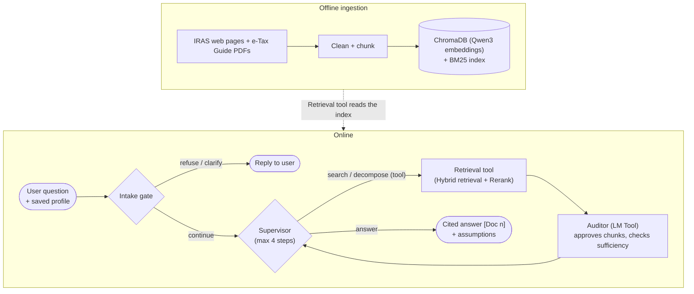

# IS469 Agentic RAG: Singapore Tax Assistant

An agentic RAG assistant that answers Singapore IRAS tax questions, mostly corporate income tax, from scraped IRAS
web pages and e-Tax Guide PDFs. Every model runs locally through Ollama (`qwen3.5:4b` by default, set in
`src/config.py`), and every answer cites its sources.

## Agentic flow



One turn, in short: the intake gate stops requests that should never reach retrieval. The supervisor then searches,
has the auditor check every retrieved chunk, and loops (search, decompose, tool, ask, answer, give up) within a step
budget (4 by default) until the approved chunks cover the question. The answer model sees only approved chunks.

## Chunking

Both sources go into one ChromaDB collection (`manuals`) with the same metadata keys (`source`, `source_type`,
`headings`, `pages`), so they are searched and ranked together. Chunks are capped at **512 tokens**, counted with the
embedder's own tokenizer. The text that gets embedded is the **heading path plus the chunk**, while the stored text is
the chunk alone, which is what the models read and cite.

**PDFs** (`src/ingest/ingest.py`, `chunking.py`)
- Docling converts each PDF with its layout and table models. OCR is off, so only text PDFs work.
- `fix_structure()` fixes two layout mistakes before chunking: an "Annex n - ..." table caption becomes a real heading
  placed before its table, and a bare "Note:" mislabelled as a section header is demoted to plain text, so it can't
  replace the real heading.
- Docling's `HybridChunker` splits by document structure and merges small sibling sections (`merge_peers`). Tables are
  serialised as Markdown rows under their header row, not as cell triplets.

**Web pages** (`src/ingest/ingest_web.py`, `web_chunking.py`)
- Pages with identical text are merged, keeping the most specific URL. Text is cleaned of file-size tags ("(PDF, 61KB)"),
  button labels and extra whitespace.
- The scraped text has almost no structure, so headings are recovered from Markdown `#` lines if any exist, or else
  from short Title-Case lines and "Example / Step n" lines. The rest is split into paragraphs, lists and tables. A
  line ending in ":" stays with the list or table it introduces.
- Blocks are packed into chunks within each section. A block that is too big on its own is split: tables by rows
  (the header repeats in every piece), lists by item, and paragraphs by sentence, then by word.

## Components

| Part | Code | Role |
|---|---|---|
| Ingest | `src/ingest/` | Converts, chunks and embeds PDFs and web pages into ChromaDB (see above). |
| Retrieval | `src/retrieval/retriever.py` | `Retriever.search(query, k)`: dense (Qwen3-Embedding) and BM25 candidates merged by reciprocal rank fusion, then reranked by the `BAAI/bge-reranker-v2-m3` cross-encoder. Returns chunks, not answers. |
| User store | `src/retrieval/user_store.py` | Per-user profile in ChromaDB. Company facts (year end, new company, tax residency) carry over to later questions. Stores pending facts across a clarification and keeps a history log. |
| Intake gate | `src/decomposer/decomposer.py` (`intake_and_plan`) | One LLM call classifies domain and intent and extracts entities. Deterministic gates then refuse out-of-scope requests, ask for missing mandatory facts (e.g. chargeable income for a computation) and normalise facts (e.g. FYE 2025 → YA 2026). |
| Decomposer (query planner) | `src/decomposer/decomposer.py` (`plan_queries`) | Called by the supervisor only when needed. Splits a multi-fact question into 1-3 keyword queries in IRAS terms, or later writes queries for just the fact the auditor reports missing. |
| Supervisor | `src/supervisor/supervisor.py` | Runs the loop. Step 1 is a route call (search as written, or decompose). After that, a decide call picks the next action. Code guard rails keep the small model in check: no answering from nothing, near-duplicate queries dropped, stops when the auditor says the chunks are sufficient or when searches stop finding anything new, and a retry after a failed search. It writes the final answer with `[Doc n]` citations, assumptions and sources. |
| Auditor | `src/auditor/auditor.py` | For each batch of chunks, approves or rejects each one for the question and year asked. It also splits the question into parts and names the chunk covering each part. From that it reports whether the batch is sufficient, what is missing and a new query to try. If it fails, chunks are kept unjudged ("fails open"). |
| Tools | passed to `Supervisor(tools=...)` | Optional calculators (e.g. `compute_tax`), offered only for computation questions. Their output becomes a citable document. |
| Front ends | `src/supervisor/harness.py`, `app.py` | Terminal chat with a `--trace` view of every step, and a Flask web chat that shows the profile and trace. |


## What was evaluated

All evaluation runs use the question set `src/evaluation/eval_questions.json` (80 questions in five types: simple,
multi-part, multi-step, computation and out-of-scope), with gold passages and reference answers.

**RAG evaluation** (`src/evaluation/rag_eval/`, run in order by `run_all.py`)
- **Retrieval ablation R0-R4:** dense, BM25, hybrid, dense + rerank, hybrid + rerank, scored on part recall, MRR and
  latency. A selection rule fixed in advance picks the mode used in every later run.
- **Systems compared:** naive RAG with dense retrieval (S1), naive RAG with the selected mode (N1), naive RAG given as
  many chunks as the agent uses (N2), and the agent (A1). Naive and agentic runs were also made with API generators
  (Anthropic, OpenAI, gpt-oss-120b).
- **Scores:** retrieval hit rates, LLM-judged correctness and correct refusal, faithfulness and context precision,
  and an optional RAGAS cross-check. `analyze.py` reports paired comparisons (A1 vs N2, A1 vs N1, N1 vs S1).

**Agent evaluation** (`src/evaluation/agent_eval/`)
- **Task success:** answered, faithfulness ≥ 0.8 and answer relevance ≥ 0.7 (LLM judge), with bootstrap CIs. On
  out-of-scope questions, success means declining.
- **Tool-call accuracy:** schema and argument validity, route agreement with question type, tool-step accuracy,
  repeated queries, and recovery from injected search faults (empty results or errors).
- **Step efficiency:** step counts, looping and wandering, budget hits.
- **Cost and latency (RQ4):** tokens, LLM calls and wall-clock time per question, agentic vs naive, with paired ratios.
- **Robustness and consistency:** 98 rewrites (paraphrase, scenario, terse, verbose, colloquial, typos) covering every
  question. Measures whether the agent still answers, and whether it gives the same answer (number agreement and a
  consistency judge).
- **Safety:** 11 poisoned-chunk and 5 user-message prompt injections, scored on attack success, which layer blocked
  them, leaks, hijacked searches and memory writes.

## Running it

Python 3.12 (3.11 also works), with Ollama running:

```powershell
python3 -m venv projenv; .\projenv\Scripts\Activate.ps1 # windows
python3 -m venv projenv; ./projenc/bin/activate # macOS
pip install -r requirements.txt
ollama pull qwen3.5:4b

python src/ingest/ingest.py          # PDFs in data/manual (--force redo, --reset rebuild); downloads models on first run
python src/ingest/ingest_web.py      # scraped pages in data/raw/*.jsonl

python src/supervisor/harness.py --user acme --trace   # terminal chat
python app.py                                          # web chat at http://localhost:8080
python -m pytest src/supervisor/ -q                    # offline tests, no Ollama needed
```

On the SMU GPU cluster, `sbatch IS469_app.sh` serves the web app (connection details go to `app_connect.<jobid>.txt`),
and `IS469_eval.sh`, `IS469_score.sh` and `IS469_task_success.sh` run the evaluations.